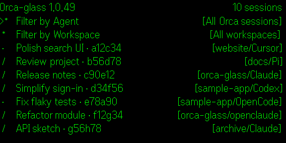
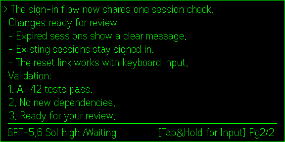
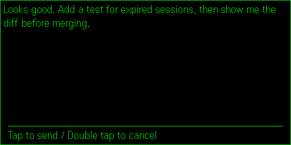
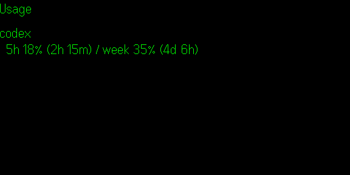
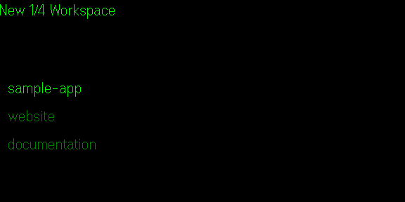
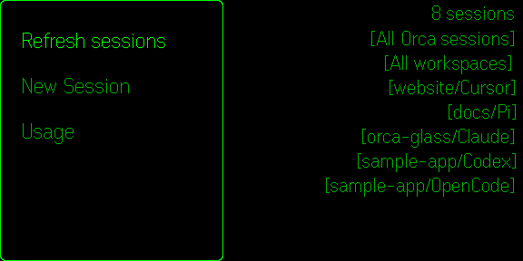

# Orca Glass

**Read your Orca sessions. Speak your next step.**

Orca Glass connects Even Realities G2 glasses to Orca on Windows. Browse connected sessions, read a conversation, check agent activity, and review a spoken instruction before sending it back to your PC.

This is Eugene's Windows/Android fork of [2ero20ne's Orca Glass](https://github.com/2ero20ne/orca-glass), licensed under MIT. Interface and speech recognition use English.

## Availability

As of 2026-11-06, the Even Hub **public build is 1.0.36** and the **latest beta is 1.0.41** (small-text reader with ten monospace pixel fonts). The newer controls described below require the beta. The installed build connects to a specific PC over Tailscale; it is not yet a self-service installation for arbitrary PCs. Orca and the companion bridge must remain running. The phone and glasses do not run the coding agent.

The active app is the custom Orca Glass bridge. Earlier native Even Terminal experiments are historical. See [current work](TODOS.md) and [beta setup/release history](docs/beta-install.md).

## Features and controls

- **Sessions:** filter by agent and by one or more Orca workspaces. Rows show `[workspace/Agent]`, for example `[porttracker/Claude]`. Swipe past the last/first row to change pages; there are no paging buttons in the sessions or workspace menus.
- **Conversation:** read nine rows of native text in whole-page swipes with `/` user / `>` assistant markers. One status row shows the state, the model, the input hint and the page, e.g. `/Waiting Opus5.5 [Tap&Hold for Input] Pg77/78`. Codex and Claude use verified saved history when available. Claude keeps previous chat visible during long runs and shows a short public activity summary. Opening a session shows the page that starts the latest response. Browsing freezes the page snapshot; swipe down on the last page to refresh and resume live updates at the latest page. Sending a voice message also resumes live updates.
- **Voice:** hold to open a full-screen voice page that is already listening; release to review the scrollable transcript; click to send, double-click to cancel. Both return to the newest chat page. Whisper transcribes on the PC.
- **Numbered prompts:** Click opens choices only when the terminal is showing a recognized interactive prompt. Review the option and click to confirm, or hold to speak a number and review before sending. The bridge rejects stale questions. Select `Type something` first for a custom response. Outside prompts, voice remains the default and Click does nothing in a session.
- **Usage:** view available Codex, Claude and Cursor allowances. Click the top Reset selector to cycle Computer time, Phone time and Absolute time (remaining duration, e.g. `2d5h12m`). The choice is remembered; missing reset timestamps are reported rather than guessed.
- **App menu:** Refresh sessions, New Session and Usage are available from the session-list contextual menu alongside the G2 system controls.
- **New session:** choose an existing Orca workspace and start Codex.

Other agents may appear in the session list and filters, but discovery does not guarantee full reader support. Tool output, internal reasoning and terminal chrome are filtered; public assistant progress commentary can still appear. New-session creation remains Codex-only.

### Hermes support (beta 1.0.28)

Browse live and saved sessions from the existing authenticated local Hermes gateway.
Sessions group as Hermes regardless of model. Verified Orca ownership supplies the
workspace; other sessions appear under `Hermes: <profile>`. Saved reading filters
hidden scaffolding, tools and reasoning. Reviewed voice replies target the exact
captured profile/session and reject stale ownership. The bridge does not start
Hermes or create sessions. Physical G2 and a real user-confirmed Hermes reply
still need verification. See [implementation](docs/hermes-bridge.md).

## Screenshots

Historical native 576 × 288 simulator captures of 1.0.21 with fictional sample data. Current beta menus and usage controls include the later changes described above.

| Sessions | Conversation | Voice review |
| --- | --- | --- |
|  |  |  |
| **Usage** | **Workspace picker** | **App actions** |
|  |  |  |

The simulator omits OS contextual entries. See [store profile/capture instructions](store/listing.md) for raw exports, the local gallery and remaining public-release preparation.

## Development

Requirements: Windows, Node.js 20+, installed/running Orca, and local Whisper for voice. The installed beta and earlier Quick Tunnel prototype use different network routes.

```powershell
npm --prefix app ci
npm test
npm --prefix app run build
npm run doctor
```

Run development servers and the simulator in named PowerShell terminals inside this repo's Orca workspace. See [project instructions](CLAUDE.md), [voice implementation](docs/voice-input.md), [reader behavior](docs/session-reader.md) and [session-list behavior](docs/session-list.md).

Pairing codes are credentials: keep them, authenticated QR files and local runtime settings out of Git and screenshots. Audio travels through the phone to the configured PC for local transcription. A confirmed reply is sent to the selected desktop agent, whose own provider/data policies then apply. Earlier prototype routes use Cloudflare and ntfy; the personal installed beta uses the configured Tailscale connection.

## License

[MIT](LICENSE). Original copyright: **Copyright (c) 2026 2ero20ne**.
Production builds include the full original notice in `LICENSE.txt` and project
links in `ATTRIBUTION.txt`. This independent fork does not imply upstream endorsement.
